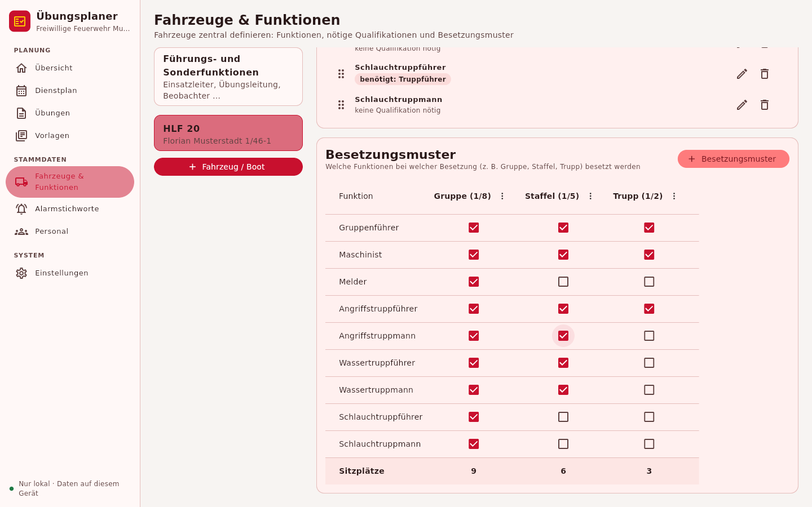

# Übungsplaner

Planungssoftware für Übungen von **Feuerwehr**, **DLRG** und weiteren Hilfsorganisationen.
Jede Organisation betreibt ihre eigene Installation. Die App läuft lokal und kann später mit
einem eigenen Server abgleichen.

| Ordner / Datei | Inhalt |
|---|---|
| `KONZEPT.md` | Konzept v1.0 mit allen Entscheidungen |
| `vorschau/index.html` | klickbare Vorschau (HTML, fiktive Daten) |
| `docs/SCHNITTSTELLE_MATERIALKOMPASS.md` | Anforderungen an die Materialkompass-API |
| `app/` | die Flutter-App |

## Stand: Etappe 1 (Stammdaten)

- Ersteinrichtung mit Organisationsprofil (Feuerwehr oder DLRG)
- **Personal & Qualifikationen**: anlegen, bearbeiten, Excel-/CSV-Import mit Spaltenzuordnung
- **Fahrzeuge & Funktionen**: Fahrzeuge aus Vorlagen (HLF 20, LF 10, TSF-W, RW, DLK, ELW 1, MTW,
  Motorrettungsboot, GW-Wasserrettung …), Funktionen mit benötigter Qualifikation, Besetzungsmuster
  (Gruppe, Staffel, Trupp …), fahrzeugunabhängige Führungs- und Sonderfunktionen
- **Alarmstichworte**: zentrale Datenbank mit AAO und Sonderrechten, Import/Export Excel/CSV
- Datensicherung der Datenbank als Datei
- Alle Datensätze haben schon die Felder für den späteren Server-Abgleich

Übungen, Dienstplan und Vorlagen folgen in den Etappen 2 bis 4.



## App starten (Entwickler)

Voraussetzung: [Flutter](https://docs.flutter.dev/get-started/install) 3.50 oder neuer.

```bash
cd app
flutter pub get
flutter run -d windows   # bzw. macos oder linux
```

Nach Änderungen an `lib/data/database.dart` den generierten Code neu erzeugen:

```bash
dart run build_runner build --delete-conflicting-outputs
```

Tests:

```bash
flutter test
```

Die Datenbank liegt im Anwendungsdatenordner (Windows `%APPDATA%`, macOS
`~/Library/Application Support`, Linux `~/.local/share`).

## Lizenz

EUPL-1.2, siehe `LICENSE`.
Taktische Zeichen (ab Etappe 6): Jonas Köritz, [taktisches-zeichen.de](https://taktisches-zeichen.de/),
[github.com/jonas-koeritz/Taktische-Zeichen](https://github.com/jonas-koeritz/Taktische-Zeichen).
