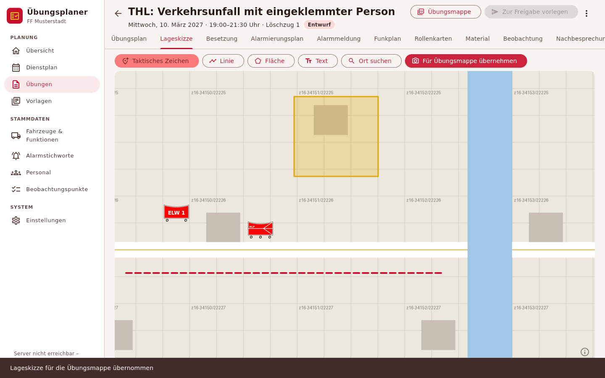
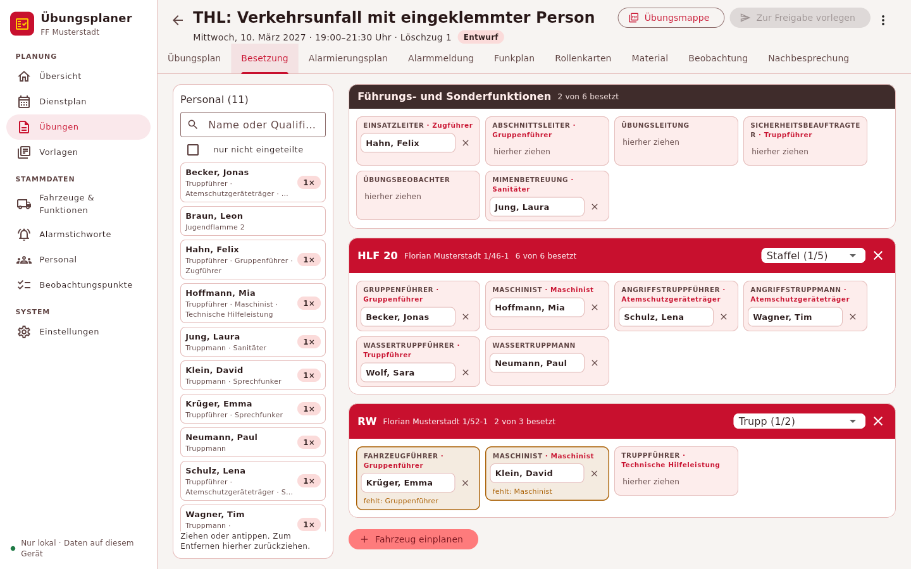
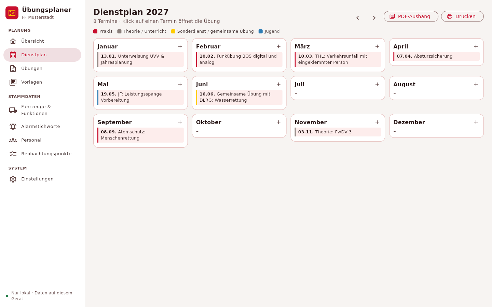
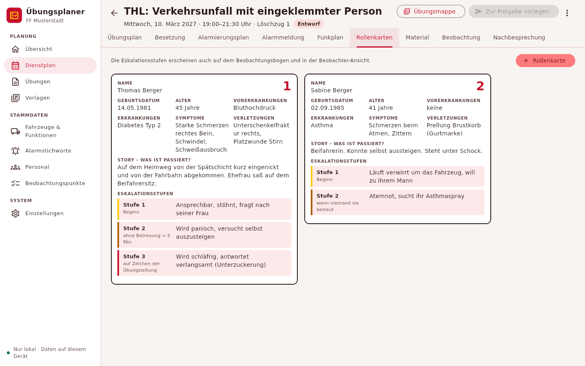
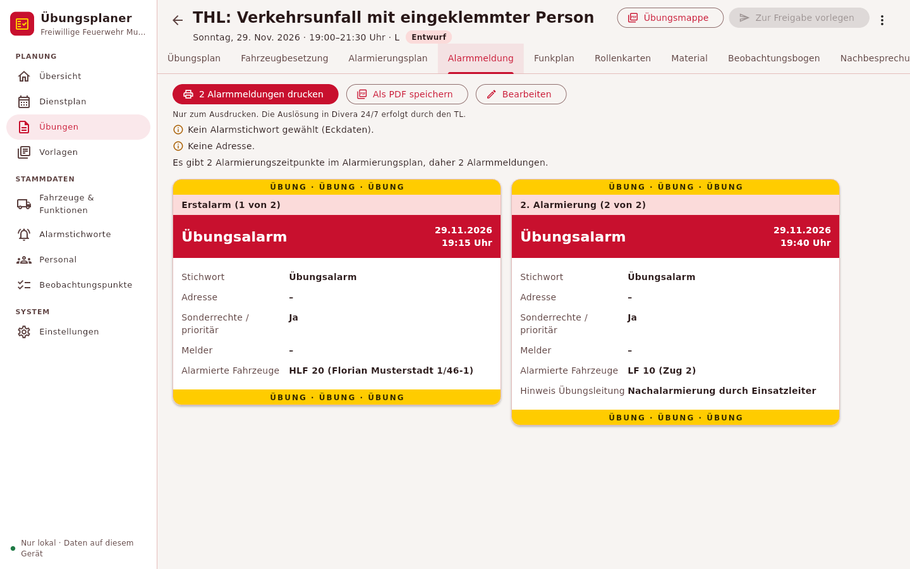

# Übungsplaner

Planungssoftware für Übungen von **Feuerwehr**, **DLRG** und weiteren Hilfsorganisationen.
Jede Organisation betreibt ihre eigene Installation. Die App läuft lokal und kann später mit
einem eigenen Server abgleichen.

| Ordner / Datei | Inhalt |
|---|---|
| `KONZEPT.md` | Konzept v1.0 mit allen Entscheidungen |
| `vorschau/index.html` | klickbare Vorschau (HTML, fiktive Daten) |
| `docs/SCHNITTSTELLE_MATERIALKOMPASS.md` | Anforderungen an die Materialkompass-API |
| `app/` | die Flutter-App |
| `server/` | der Übungsplaner-Server (Dart) |

## Stand: Version 2.0

Neu gegenüber 1.0: **Server** mit Benutzerrollen und Abgleich mehrerer Geräte ([`docs/SERVER.md`](docs/SERVER.md)),
**Tablet-App** (Android, nur ansehen), **Lageskizze** mit Karte (online/offline) und taktischen Zeichen,
**Materialkompass**-Anbindung mit Fahrzeugreservierung, **Slippen** im Alarmierungsplan (Boot fährt auf dem Anhänger
mit einem Fahrzeug zur Slipstelle, danach getrennte Ziele, Aufgaben und Ankunftszeiten).




### Funktionen aus Version 1.0

**Anleitung für Anwender:** [`docs/ANLEITUNG.md`](docs/ANLEITUNG.md). Dort steht auch, wie ihr die fertigen Programme für Windows, macOS und Linux bekommt.

- **Stammdaten**: Personal mit Qualifikationen (Excel-Import), Fahrzeuge mit Funktionen und Besetzungsmustern,
  Führungs- und Sonderfunktionen, Alarmstichworte, Katalog für Beobachtungspunkte
- **Übungen** mit Übungsplan, Sicherheits-Checkliste, Freigabe durch TL/Wehrführer,
  Fahrzeugbesetzung per Drag & Drop, Alarmierungsplan (Uhrzeit oder relativ),
  **eine Alarmmeldung je Alarmierungszeitpunkt**, Funkplan, Rollenkarten mit Eskalationsstufen,
  Material, Beobachtungsbogen, Nachbesprechung
- **Übungsmappe** als PDF oder Ausdruck (Teile wählbar), Beobachter-Ansicht
- **Dienstplan** mit Kategorien und PDF-Aushang, **Vorlagen** (auch als Datei austauschbar)
- Erkenntnisse aus Nachbesprechungen fließen über die Übersicht in neue Übungen
- Beispieldaten zum Ausprobieren, Datensicherung






## App starten (Entwickler)

Voraussetzung: [Flutter](https://docs.flutter.dev/get-started/install) 3.50 oder neuer.

```bash
cd app
flutter pub get
flutter run -d windows   # bzw. macos oder linux
```

Nach Änderungen an `lib/data/database.dart` den generierten Code neu erzeugen:

```bash
dart run build_runner build --delete-conflicting-outputs
```

Tests:

```bash
flutter test
```

Wo die Datenbank liegt, steht in `docs/ANLEITUNG.md`.

## Lizenz

EUPL-1.2, siehe `LICENSE`.
Schrift im PDF: DejaVu Sans (freie Lizenz, siehe `app/assets/fonts/LICENSE-DejaVu.txt`).
Taktische Zeichen (ab Etappe 6): Jonas Köritz, [taktisches-zeichen.de](https://taktisches-zeichen.de/),
[github.com/jonas-koeritz/Taktische-Zeichen](https://github.com/jonas-koeritz/Taktische-Zeichen).
