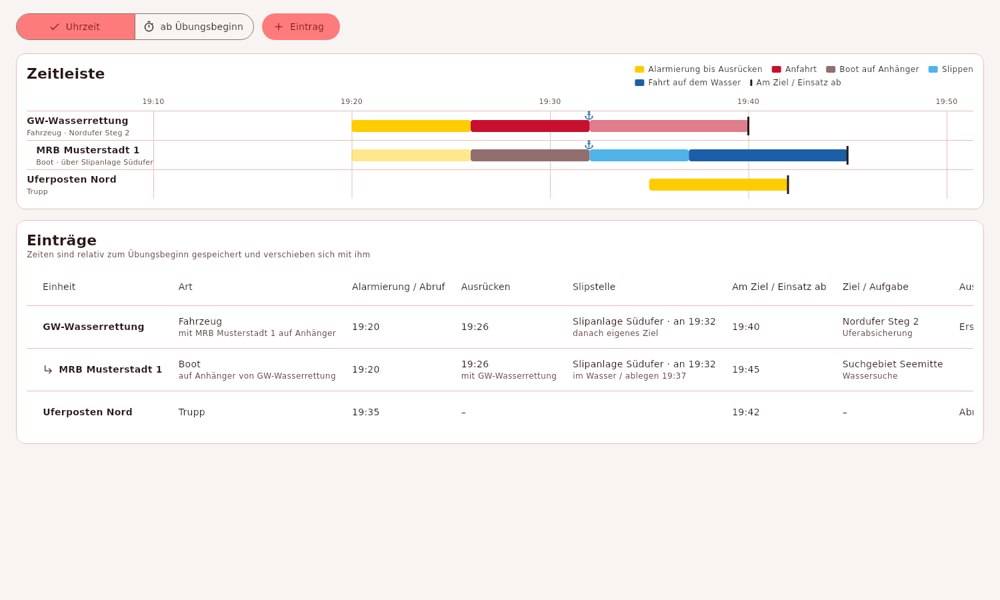
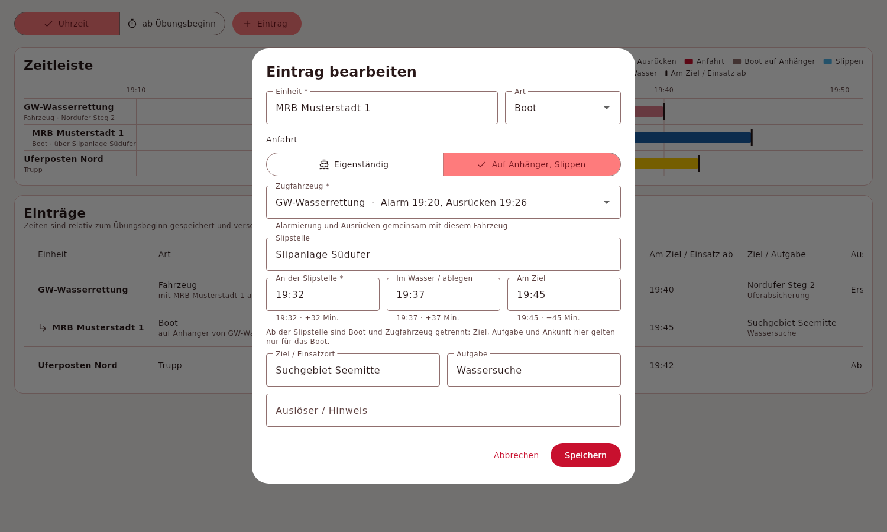

# Übungsplaner – Anleitung (Version 1.0)

## 1. Installieren

Die fertigen Programme baut GitHub automatisch (Workflow **„Programme bauen“**).

1. Im Repository auf **Actions → Programme bauen → Run workflow** klicken (oder einen Tag wie `v1.0.0` setzen).
2. Nach ca. 15 Minuten im Lauf unten unter **Artifacts** herunterladen:

| System | Datei | Starten |
|---|---|---|
| Windows | `Uebungsplaner-Windows.zip` | entpacken, `uebungsplaner.exe` starten |
| macOS | `Uebungsplaner-macOS.zip` | entpacken, `uebungsplaner.app` mit Rechtsklick → *Öffnen* (die App ist nicht von Apple signiert) |
| Linux | `Uebungsplaner-Linux.tar.gz` | entpacken, `./uebungsplaner` starten |

Die Daten liegen im Anwendungsdatenordner des Benutzers:

- Windows: `%APPDATA%\Uebungsplaner\Uebungsplaner\`
- macOS: `~/Library/Containers/de.uebungsplaner.uebungsplaner/Data/Library/Application Support/de.uebungsplaner.uebungsplaner/`
- Linux: `~/.local/share/de.uebungsplaner.uebungsplaner/`

Ein Update ersetzt nur das Programm, die Daten bleiben erhalten.

## 2. Erster Start

1. Name der Organisation eintragen und **Feuerwehr** oder **DLRG** wählen.
2. Zum Ausprobieren: **Einstellungen → Beispieldaten laden**. Das ist nur möglich, solange noch nichts angelegt ist.
3. Für den echten Betrieb:
   - **Personal**: Personen anlegen oder eine Excel-/CSV-Liste importieren (Spalten werden zugeordnet).
   - **Fahrzeuge & Funktionen**: Fahrzeuge aus Vorlagen anlegen (HLF 20, LF 10, RW, ELW 1, MRB, GW-Wasserrettung …). Funktionen, benötigte Qualifikationen und Besetzungsmuster prüfen.
   - **Alarmstichworte**: Stichworte anlegen oder per Excel/CSV importieren.
   - **Beobachtungspunkte**: zentralen Katalog anlegen oder importieren.

## 3. Eine Übung planen

**Übungen → Neue Übung** (oder **Dienstplan → +** im Monat, oder **Aus Vorlage**).

| Reiter | Was ihr dort macht |
|---|---|
| Übungsplan | Eckdaten, Lernziele, Lage, Ablauf, Sicherheits-Checkliste |
| Besetzung | Fahrzeuge einplanen, Besetzungsmuster wählen, Personen per **Drag & Drop** auf Funktionen ziehen (oder Person antippen → Funktion antippen). Gelb = Qualifikation fehlt. Eine Person darf mehrere Funktionen haben. |
| Alarmierungsplan | Wer wird wann alarmiert/abgerufen, rückt aus, ist am Ziel, mit eigenem **Ziel** und eigener **Aufgabe**. Zeiten als Uhrzeit (`19:15`) oder ab Beginn (`+15`). **Slippen**: siehe unten. |
| Alarmmeldung | Ausdruck im Aufbau der Divera-Meldung. **Je Alarmierungszeitpunkt eine eigene Meldung** (Erstalarm, Nachalarmierung …). Die Auslösung in Divera macht der TL. |
| Funkplan | Rufnamen, Funknetz (BOS digital/analog, DLRG-Betriebsfunk), Gruppe/Kanal, Aufgabe |
| Rollenkarten | Mimen mit Name, Geburtsdatum/Alter, Vorerkrankungen, Erkrankungen, Symptomen, Verletzungen, Story und **Eskalationsstufen** |
| Material | Materialliste |
| Beobachtung | Beobachtungspunkte (frei oder aus dem Katalog) mit Bewertung und Notiz; Eskalationsstufen der Mimen |
| Nachbesprechung | Was lief gut / besser machen, Maßnahmen mit Zuständigen. Offene Maßnahmen erscheinen in der **Übersicht** und lassen sich mit „In Übung übernehmen“ als Lernziel in eine kommende Übung übernehmen. |

#### Slippen: Boot auf dem Anhänger

Wenn ein Fahrzeug ein Boot auf dem Anhänger zu einer Slipstelle bringt:

1. Das Zugfahrzeug als normalen Eintrag (Art *Fahrzeug*) anlegen.
2. In seiner Zeile auf das **Boot-Symbol** tippen (oder beim Boot unter *Anfahrt* „Auf Anhänger, Slippen“ wählen).
3. Zugfahrzeug, **Slipstelle**, Zeitpunkt **an der Slipstelle**, **im Wasser / ablegen** und **Am Ziel** eintragen.

Bis zur Slipstelle fährt das Boot mit dem Zugfahrzeug: Es wird mit ihm alarmiert und rückt mit ihm aus. Ändert ihr
die Alarmierung des Zugfahrzeugs, wandert das Boot mit, und es steht auf derselben Alarmmeldung („auf Anhänger von …“).
Ab der Slipstelle sind beide getrennt: Das Boot hat sein eigenes Ziel, seine eigene Aufgabe und Ankunftszeit, das
Fahrzeug fährt zu *seinem* Ziel weiter (dort ist „Am Ziel“ die Ankunft nach dem Slippen). Wird das Zugfahrzeug gelöscht,
bleibt das Boot als eigenständiger Eintrag mit seinen Zeiten erhalten.

Oben rechts:

- **Übungsmappe**: Teile auswählen und dann drucken oder als PDF speichern. Die Mappe enthält Übungsplan, Besetzung, Alarmierungsplan, alle Alarmmeldungen, Funkplan, je Mime eine Rollenkarte, Material, Beobachtungsbogen und Nachbesprechungsprotokoll.
- **Zur Freigabe vorlegen / Freigeben**: Das geht erst, wenn die Sicherheits-Checkliste vollständig ist. Die Freigabe erteilt TL oder Wehrführer mit Namen. Sie lässt sich in den Einstellungen abschalten.
- **⋮**: Beobachter-Ansicht (große Schrift, nur lesen, z. B. fürs Tablet), Als Vorlage speichern, Übung kopieren, Löschen.

## 4. Lageskizze und Karten

Reiter **Lageskizze** in jeder Übung:

- **Taktisches Zeichen** wählen (über 400 Zeichen von taktisches-zeichen.de, mit Suche) und auf die Karte tippen
- **Linie** (z. B. Absperrung, Schlauchleitung), **Fläche** (z. B. Gefahrenbereich, Suchabschnitt), **Text**
- Element antippen: beschriften, Farbe ändern, verschieben, löschen
- **Ort suchen** (benötigt Internet) oder die Karte von Hand verschieben
- **Für Übungsmappe übernehmen** speichert ein Bild; es erscheint als Seite „Lageskizze“ mit Legende in der Mappe

**Kartenquelle** (Einstellungen → Karten, gilt je Gerät):

- *Online*: OpenStreetMap
- *Offline*: eine **MBTiles-Datei** eures Landkreises
- *Offline, sonst online*: Offline-Karte, fehlende Bereiche aus dem Internet

**Offline-Karte erstellen** (einmalig, z. B. mit dem kostenlosen Programm QGIS):

1. In QGIS die amtliche Karte eures Landes als WMS-Dienst einbinden (Rheinland-Pfalz: Geobasisdaten des
   Landesamts für Vermessung und Geobasisinformation, frei nutzbar mit Quellenangabe) oder eine andere Karte, die ihr offline nutzen dürft.
2. *Verarbeitung → Werkzeugkiste → „XYZ-Kacheln erzeugen (MBTiles)“*: Ausdehnung = Landkreis,
   Zoom 10 bis 17 (für Einsatzstellen ggf. bis 18), Format PNG oder JPG.
3. Bei den Metadaten unter *Attribution* die Quellenangabe eintragen (erscheint auf Karte und Mappe).
4. Im Übungsplaner unter *Einstellungen → Karten → Datei wählen*.

Hinweis: Die Kacheln von tile.openstreetmap.org dürfen nicht massenhaft heruntergeladen werden; deshalb
erzeugt die App selbst keine Offline-Karten.

## 5. Materialkompass

**Einstellungen → Materialkompass**: Adresse der Schnittstelle und API-Schlüssel eintragen,
*Speichern und prüfen*, dann *Jetzt abgleichen*.

- **Fahrzeuge** werden über Bezeichnung oder Funkrufname zugeordnet; Status (z. B. „in Werkstatt“)
  und Funkrufname werden übernommen. Fehlende Fahrzeuge bietet die App zum Anlegen an.
- **Material** wird auf dem Gerät zwischengespeichert und steht in jeder Übung unter
  *Material → Aus Materialkompass* zur Auswahl (auch ohne Verbindung).
- **Reservierung**: Ein Administrator schaltet *Planer dürfen Fahrzeuge reservieren* ein. Dann zeigt die
  Fahrzeugbesetzung je Fahrzeug *In Materialkompass reservieren*. Reservierungen sind dort
  genehmigungspflichtig; der Status (angefragt / bestätigt / abgelehnt) wird angezeigt und lässt sich
  aktualisieren oder stornieren.

## 6. Dienstplan und Vorlagen

- **Dienstplan**: Jahresübersicht nach Monaten, farbig nach Kategorie (Praxis, Theorie, Sonderdienst, Jugend). Den Aushang gibt es als PDF oder direkt zum Drucken.
- **Vorlagen**: Aus einer Vorlage wird mit einem Klick eine neue Übung. Vorlagen lassen sich als Datei (`.uebung.json`) **exportieren und importieren**, z. B. für andere Wehren oder Ortsgruppen. Personen sind nie in der Datei. Fahrzeuge und Stichworte werden über ihren Namen zugeordnet.

## 7. Datensicherung

**Einstellungen → Datensicherung → Sichern** speichert eine komplette Kopie der Datenbank. Am besten regelmäßig sichern, z. B. auf einen USB-Stick.

Zurückspielen: Programm beenden und die Sicherungsdatei als `uebungsplaner.sqlite` in den Datenordner (siehe oben) kopieren.

## 8. Mehrere Geräte und Tablets

Siehe [`SERVER.md`](SERVER.md): Server einrichten, Benutzer und Rollen, Zugriff von zu Hause über VPN,
Android-App für Tablets (nur ansehen).

## 9. Was noch fehlt (geplant)

- Import der Stichworttabelle Rheinland-Pfalz (sobald die Quelle vorliegt)
- iPad-App (zum Verteilen ist ein Apple-Entwicklerkonto nötig; die App selbst ist vorbereitet)
